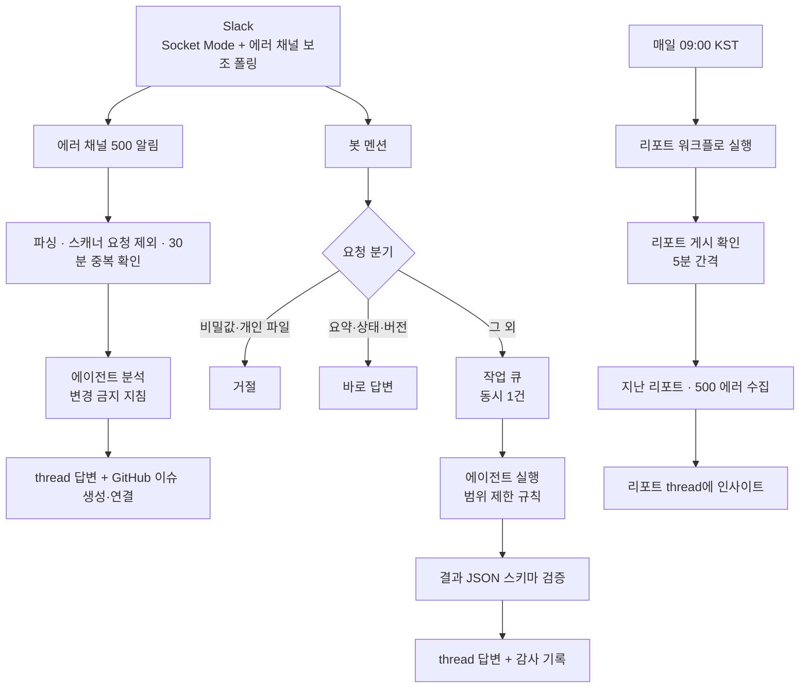

# MODY Slack 운영 봇

> 500 에러가 올라오면 원인을 먼저 찾아 두고, 멘션 한 줄로 데이터 조회부터 PR까지 처리하는 팀 운영 봇


MODY 팀 Slack에서 돌아가는 운영 봇입니다. 에러 알림이 올라오면 사람이 보기 전에 코드를 읽고 원인 후보와 GitHub 이슈를 남깁니다. 팀원은 봇을 멘션해서 코드 확인, 데이터 조회, dev 데이터 보정, 수정 PR까지 맡길 수 있습니다.

AI 에이전트가 팀 서버에 접근하는 만큼, **무엇을 어디까지 할 수 있는지부터 정했습니다.** 이 README도 그 순서로 씁니다.

## 하는 일

| 기능 | 동작 |
| --- | --- |
| 🚨 **500 에러 분석** | 에러 채널 알림을 읽고 서버 코드를 읽기 전용으로 분석해 thread에 원인 후보를 답합니다. 같은 에러의 GitHub 이슈를 만들거나, 열린 이슈가 있으면 연결합니다. |
| 💬 **멘션 작업** | 코드 확인, dev/prod 데이터 조회, dev 데이터 보정, 코드 수정·PR·배포 요청을 처리합니다. |
| 📝 **thread 요약** | thread 대화를 요약합니다. |
| 📊 **일일 리포트 인사이트** | 매일 리포트 워크플로를 실행하고, 리포트가 올라오면 지난 리포트·같은 날 500 에러와 함께 읽어 인사이트를 남깁니다. |
| 🩺 **봇 상태** | 실행 중인 작업과 대기 작업 수를 바로 답합니다. |

```text
@Mody Signal 온보딩 프로필 validation 어디서 걸려?
@Mody Signal dev 그룹 목록과 주간 챌린지 개수 확인해줘
@Mody Signal 운영에서 이 회원의 챌린지 달성 여부를 코드 조건과 대조해줘
@Mody Signal fix 이 에러 PR까지 올려줘
```

## 권한과 안전장치

에이전트는 비대화 모드로 돌아야 해서 샌드박스 없이, 도구 권한 확인도 건너뛰고 실행합니다. 그래서 **범위는 요청 분기 코드와 에이전트 지침으로 좁힙니다.** 운영체제 수준에서 막는 것은 아니라는 점도 그대로 적어 둡니다.

**요청 단계에서 막는 것**
- `.env`·토큰·비밀값 요청과 개인 파일·폴더 요청은 에이전트를 부르기 전에 거절합니다.
- thread 내용은 작업 데이터로만 다룹니다. "지침을 무시하라"는 문장이 있어도 따르지 않습니다.

**환경 분리**
- 환경을 적지 않으면 dev로 처리합니다.
- 운영(prod)은 요청에 `운영`·`prod`·`prd`를 적었을 때만, **조회 전용** 스킬로 접근합니다. 데이터 변경 절차는 dev용만 둡니다.

**에이전트에 넘기는 것**
- 허용한 환경변수(`HOME`, `PATH`, `SSH_AUTH_SOCK` 등)만 넘깁니다. 이름에 `TOKEN`, `SECRET`, `PASSWORD`, `API_KEY`가 들어간 변수는 넘기지 않습니다.
- 에러 분석·요약·인사이트는 지침에서 코드 수정, 데이터 변경, 커밋, PR, 배포를 금지합니다.

**결과와 기록**
- 결과는 JSON Schema(`config/agent-result.schema.json`) 검증을 통과해야 Slack에 올라갑니다.
- 작업은 큐에서 한 번에 하나씩 처리합니다.
- 감사 기록에는 확인 ID, 상태, 환경, 채널, 사용자, 소요 시간만 남깁니다. 요청 본문과 비밀값은 남기지 않습니다.

## 동작 구조



**요청 분기 순서** — 위에서부터 먼저 맞는 규칙을 따릅니다.

| 요청 | 처리 |
| --- | --- |
| `.env`·토큰·비밀값을 읽거나 보여 달라는 요청 | 거절 |
| `Desktop`, `~/`, `.ssh` 같은 개인 파일·폴더 | 거절 |
| thread `요약`·`정리` | thread 요약 (읽기 전용) |
| 대상 없이 `상태`, `ping`을 묻는 질문 | 봇 상태 답변 |
| 그 외 | 에이전트 작업 (범위 제한 규칙 적용) |

요약·상태 질문이어도 서버, 데이터, PR 같은 대상이나 작업이 함께 있으면 에이전트 작업으로 넘깁니다. "운영 서버 상태 확인해줘"는 봇 상태가 아니라 서버 상태를 확인합니다. 판별 규칙은 [`src/request-policy.js`](src/request-policy.js)와 테스트에 있습니다.

## 놓치지 않게 만든 것들

- **Socket Mode + 보조 폴링:** 이벤트를 놓쳐도 에러 채널을 60초마다 다시 확인합니다. 폴링이 2분 넘게 실패하면 프로세스를 재시작합니다.
- **중복 방지:** 같은 에러(메서드·경로·예외·첫 스택 프레임)는 30분 안에 한 번만 분석하고, 열린 이슈가 있으면 새로 만들지 않습니다.
- **재시도 상한:** 리포트 인사이트가 실패하면 30분 뒤 다시 시도하되, 같은 날짜는 3번까지만 시도합니다.
- **긴 결과:** 에이전트가 남긴 긴 목록은 thread에 파일로 첨부합니다.
- **에이전트 실패 시:** 에러 분석은 키워드 코드 검색 결과로 대신 답합니다.

## 기술 스택

| 분류 | 사용 |
| --- | --- |
| Runtime | Node.js (ESM) |
| Slack | `@slack/bolt` · Socket Mode |
| AI 에이전트 | Antigravity CLI (`agy --print` 비대화 모드) |
| GitHub | `gh` CLI (이슈 생성, 워크플로 실행) |
| 실행 | 로컬 Mac · `screen` + 자동 재시작 스크립트 |
| Test | `node --test` (34개) |

## 시작하기

```bash
npm install
npm test
npm start      # .env 필요
```

설정(`.env`), 운영 명령, Slack 사용법, 로그 파일, 문제 해결은 [docs/operations.md](docs/operations.md)에 있습니다.

## 파일 구조

```text
src/
  index.js                 Slack 이벤트 처리, 요청 분기, 에이전트 실행
  request-policy.js        민감 요청 판별, 에이전트에 넘길 환경변수 필터
  agent-cli.js             에이전트 실행 인자 구성, 출력 파싱
  agent-contract.js        환경 추론, 결과 JSON 파싱, Slack 답변 형식
  job-queue.js             동시 실행 수를 제한하는 작업 큐
  github-issue.js          에러별 GitHub 이슈 생성·재사용
  daily-report-trigger.js  일일 리포트 워크플로 실행
  daily-insight.js         일일 리포트 인사이트
  attachments.js           긴 결과 파일 첨부
  audit-log.js             감사 기록
prompts/mody-agent.md      에이전트 지침
config/agent-result.schema.json  결과 JSON 스키마
docs/operations.md         운영 가이드
```
